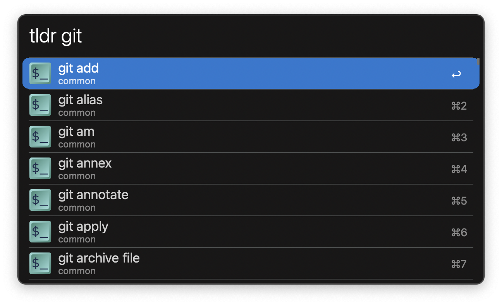
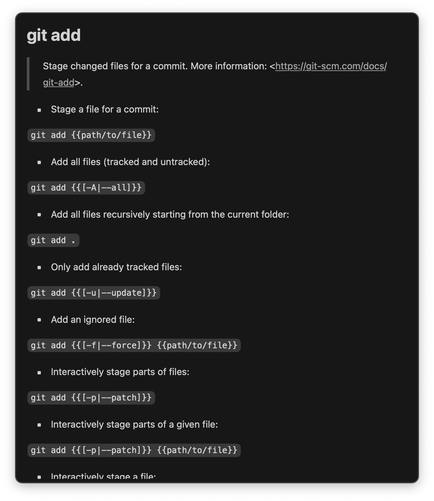

#  TLDR Pages Alfred Workflow

Look up [tldr-pages](https://tldr.sh) cheatsheets with Alfred

[⤓ Download the workflow](https://github.com/iAli/tldr-pages-workflow/releases/latest)

## Usage

Look up tldr-pages cheatsheets via the `tldr` keyword.

